# Gas analysis: why harvesting and distributing yield is expensive

Measured on Stellar mainnet, 2026-10-09 (ledger ~64,840,000, protocol 29).
Nothing was submitted. All numbers come from RPC simulation of the deployed contracts
plus the fees actually charged to the admin account in the past.

Second pass (same day) extends the analysis to the **yield-claimer** service and the **front-end**
(sections 8 to 11) and adds one local build experiment on the adapter. Options and trade-offs are in
[SOLUTIONS.md](SOLUTIONS.md).

## TL;DR

1. **Compute is not the problem.** A full `harvest_yield` uses 18.4M CPU instructions out of
   the 400M allowed per transaction (4.6%). CPU, ledger I/O and transaction size together cost
   about **0.012 XLM** of the simulated **53.7 XLM** fee. Memory is a hard cap (40 MB), it is never billed.
2. **99.98% of the fee is rent.** Every Soroban ledger entry has a TTL. When the TTL expires the entry is
   archived, and the next transaction that touches it must pay to restore it for the network minimum of
   **2,073,600 ledgers (about 120 days)** up front.
3. **Our contracts always expire between harvests.** The yield controller and Blend adapter only ever
   extend their own TTL by 7 days, the distributor by 30, and the harvest cadence is 30 days or longer.
   Today every single Coopstable entry except the distributor instance and the registry is expired.
4. **WASM is what costs.** Rent on a contract-code entry is charged on the WASM bytes *plus the compiled
   module's memory footprint* (divided by 3). Measured: restoring 1 KB of WASM costs **~1.5 XLM**, restoring
   1 KB of plain data costs **~0.2 XLM**. The Blend adapter (21.4 KB) and yield controller (13.9 KB) WASM
   restores alone are 53.6 of the 53.7 XLM.
5. **Steady state is cheap.** The February 2026 cycle (all entries still live) cost **0.235 XLM** for all
   three stages. The same cycle today costs an estimated **~84 XLM** (harvest 53.7 + recompound ~0.01 +
   finalize ~30), to distribute 3.47 USDC of yield.
6. **It is about to get worse.** The network rent rate is currently clamped at its floor (1,000 stroops
   per KB per 1,215 ledgers). Live Soroban state is 1.95 GB; the rate leaves the floor at 2.0 GB and
   rises linearly to 10x at the 3 GB target.

The protocol's "cost of existing" on mainnet at today's rate is roughly **0.75 XLM per day**
(about 93 XLM per 120-day TTL period), paid in lumps whenever something is touched after it expired.

Added by the second pass (claimer, front-end, contracts):

7. **The yield-claimer is the only component that could keep the contracts alive, and by design it never
   touches them between distributions.** It wakes every 12 hours, runs two read simulations and sleeps unless a
   distribution is due. It has not submitted anything since 2026-06-17 although a distribution has been due since
   2026-07-17 and its reads succeed today. It is most likely not running. When it comes back it will pay ~84 XLM
   for the pending 3.47 USDC.
8. **Restores are no longer a separate step.** On protocol 29 the RPC folds archived entries into the invoke
   itself (`archivedSorobanEntries`): simulation returns `SUCCESS` with the restore inside `minResourceFee`.
   The `isSimulationRestore` / `restoreFootprint` branches in the claimer and the front-end are dead code, and
   nothing in either codebase looks at the fee before signing.
9. **Members pay the restore if they get there first.** A mint or burn signed in the front-end today declares
   **61.10 XLM** (8 archived entries). Warm, the same call is ~0.015 XLM. The wallet shows the fee; a wallet
   holding less than 61 XLM fails with `txInsufficientBalance`.
10. **Front-end reads are free but heavy.** An open `/yield-distribution` tab runs ~1.5 simulations per second
    against the public RPC (`time_before_next_distribution` every second, `get_yield` every 3 s at 9.9M
    instructions). No XLM, but every call also computes the cold-restore footprint.
11. **22% of the adapter WASM is a test mock.** `pub mod mocks` is compiled into the mainnet adapter: 11 of its
    27 exported functions are a fake Blend pool. Gated behind `cfg(test)` the optimized WASM drops from 21,412
    to 16,656 bytes, ~7.4 XLM less per 120 days of rent and per upload.
12. **Extending costs exactly what restoring costs, per day.** Measured: extending the live registry code to
    120 days = 8.19 XLM for 103 days of new TTL; its restore in June was 8.51 XLM for 120 days. Keep-alive does
    not lower the bill, it changes its shape (0.78 XLM/day, 23.5 XLM/month, ~285 XLM/year at today's rate).
    The only levers on the total are bytes on the ledger and the rent rate, which can be locked in by prepaying
    up to 180 days.
13. **Each release pays rent again.** The April 6 to 7 release uploaded four WASMs for 62.4 XLM.

---

## 1. How Stellar charges a Soroban transaction (60 seconds)

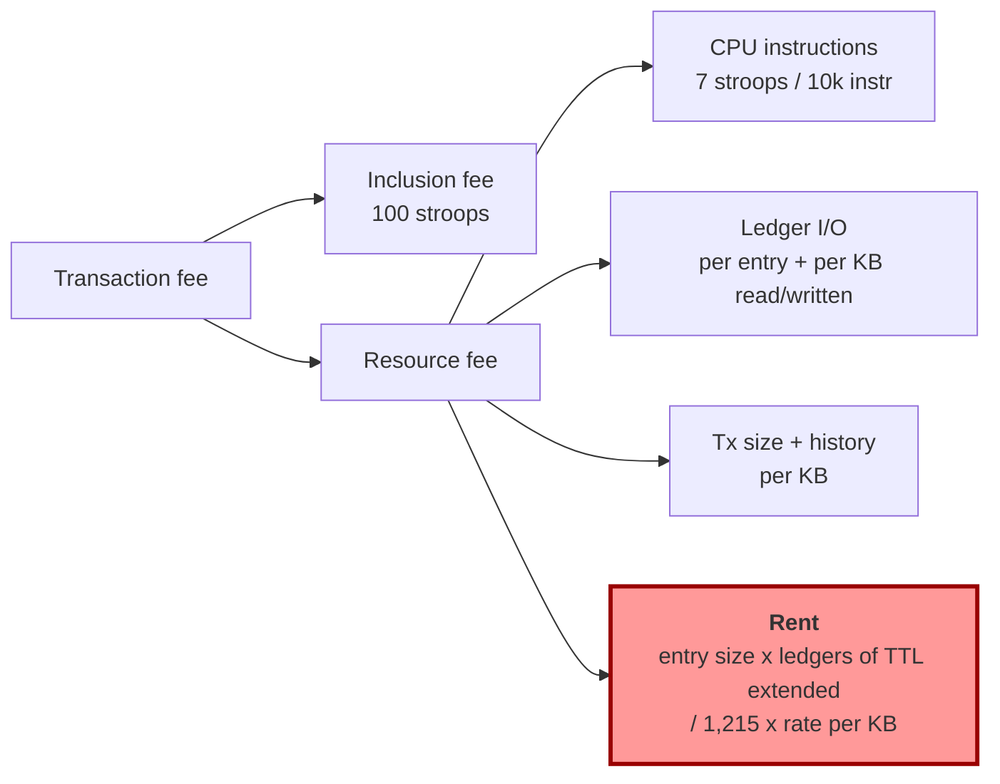

Mainnet settings that matter here (from `stellar network settings --network mainnet`):

| Setting | Value | Meaning |
|---|---|---|
| `tx_max_instructions` | 400,000,000 | CPU cap per tx |
| `tx_memory_limit` | 41,943,040 | 40 MB cap, not billed |
| `fee_rate_per_instructions_increment` | 7 | per 10,000 instructions |
| `fee_write_ledger_entry` / `fee_write1_kb` | 2,500 / 875 | write cost |
| `min_persistent_ttl` | 2,073,600 ledgers | ~120 days; TTL every restored entry gets |
| `persistent_rent_rate_denominator` | 1,215 | rent = size x rate x ledgers / (1024 x 1215) |
| rent rate per KB | 1,000 (floor) | formula gives 728 at 1.95 GB state; clamped to 1,000 |
| `rent_fee1_kb_soroban_state_size_high` | 10,000 | rate when live state reaches 3 GB |

Rent for contract **code** is special (`soroban-env-host` `e2e_invoke.rs::entry_size_for_rent`):
`size_for_rent = wasm_bytes + compiled_module_memory_cost`, then the fee is divided by
`CODE_ENTRY_RENT_DISCOUNT_FACTOR = 3`. In practice this makes WASM ~7-8x more expensive per raw byte than data.

---

## 2. Evidence

### 2.1 Fees actually charged (admin account `GD2W…WIDB`)

| Date | Stage | Fee charged | XLM | CPU instr | What was restored (archived entries in the footprint) |
|---|---|---:|---:|---:|---|
| 2026-02-19 | harvest_yield | 644,763 | 0.064 | 10.2M | nothing, all live |
| 2026-02-19 | recompound_yield | 41,450 | 0.004 | | nothing |
| 2026-02-19 | finalize_distribution | 1,666,437 | 0.167 | 12.5M | nothing |
| 2026-05-07 | harvest_yield | 288,147,671 | **28.81** | 19.1M | controller instance, **adapter code (21,388 B)** |
| 2026-05-07 | recompound_yield | 35,689 | 0.004 | 8.4M | nothing |
| 2026-05-07 | finalize_distribution | 66,379,721 | **6.64** | 16.0M | Member, Members, cUSD SAC instance, manager instance, **manager code (4,260 B)** |
| 2026-06-17 | harvest_yield | 85,117,672 | **8.51** | 12.2M | registry map, registry instance, **registry code (5,880 B)** |
| 2026-06-17 | recompound_yield | 35,689 | 0.004 | 8.4M | nothing |
| 2026-06-17 | finalize_distribution | 2,279,290 | 0.228 | 14.4M | distributor instance |

Same code, same CPU, fee swings from 0.004 XLM to 28.8 XLM depending only on which entries had expired.

Older history for context: Sept 11 to Oct 3 2025 a daily cron ran the old single-transaction
`claim_yield` on the previous controller (`CB2RILXU…`); 20 of them failed with
`resource_limit_exceeded` (execution exceeded the resources declared at simulation time) at 0.033 XLM each.
That is the "exceedlimit" problem the 3-stage split fixed. It was unrelated to the rent problem.

### 2.2 Simulated today (every Coopstable entry expired)

| Call | CPU instr | Bytes written | Entries restored | Min resource fee | XLM |
|---|---:|---:|---:|---:|---:|
| controller `harvest_yield` | 18,381,494 | 37,820 | 5 | 537,079,583 | **53.71** |
| controller `get_yield` (a read!) | 9,891,451 | 36,468 | 4 | 536,138,007 | **53.61** |
| controller `get_adapter_registry` | 2,807,912 | 14,416 | 2 (controller instance + code) | 204,696,053 | 20.47 |
| adapter `protocol_token` | 3,935,890 | 22,052 | 2 (adapter instance + code) | 330,949,850 | 33.09 |
| manager `issue_cusd` | 2,361,748 | 19,952 | 7 | 279,962,763 | 28.00 |
| manager `get_cusd_id` | 1,359,944 | 4,660 | 2 (manager instance + code) | 73,604,130 | 7.36 |
| distributor `get_current_epoch` | 3,004,888 | 13,908 | 1 (distributor code) | 218,586,406 | 21.86 |
| distributor `get_distribution_history` | 3,412,106 | 15,004 | 4 | 220,715,200 | 22.07 |
| registry `get_adapter` (live) | 602,765 | 0 | 0 | 76,796 | 0.008 |
| Blend pool `get_positions` (live) | 837,238 | 0 | 0 | 441,457 | 0.044 |
| Blend pool `get_reserve` (live) | 1,157,095 | 0 | 0 | 18,453 | 0.002 |

Non-rent part of the harvest fee, from the network settings:
CPU 12,873 + write entries 20,000 + read entries 28,134 + read bytes 16,017 + write bytes 32,314 +
tx size/history ~7,000 = **~116,000 stroops = 0.012 XLM**. The rest (537M stroops) is rent.

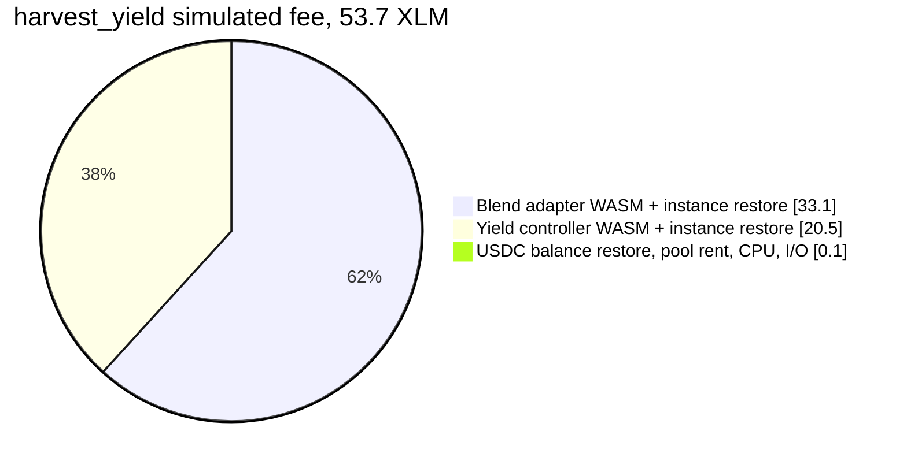

### 2.3 Measured restore price per contract (today)

| Entry set | Raw bytes | Fee (stroops) | XLM | XLM per raw KB |
|---|---:|---:|---:|---:|
| Blend adapter instance + code | 22,036 | 330,949,850 | 33.09 | 1.54 |
| Yield controller instance + code | 14,400 | 204,696,053 | 20.47 | 1.46 |
| Yield distributor code | 13,900 | ~217,800,000 | 21.78 | 1.60 |
| cUSD manager instance + code | 4,644 | 73,604,130 | 7.36 | 1.62 |
| Distributor data (Distribution x2, Distributions) | 1,072 | ~2,100,000 | 0.21 | 0.20 |

Rule of thumb at the current rate: **1 KB of WASM = 1.5 XLM per 120 days, 1 KB of data = 0.2 XLM per 120 days.**

---

## 3. What is on the ledger and what state it is in

Every entry the harvest/finalize path touches, with its size and TTL status at the time of measurement.

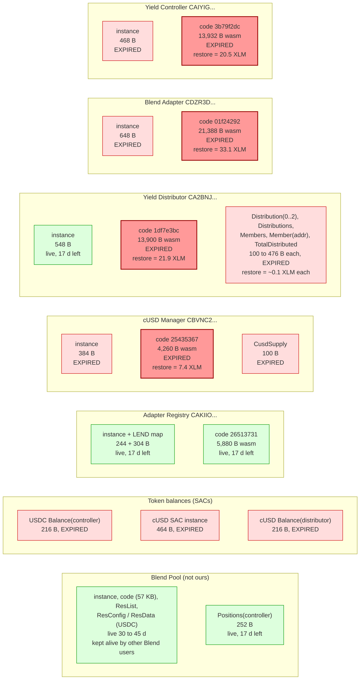

Total Coopstable footprint: ~59 KB of WASM across 5 contracts + ~5 KB of instances and data.

---

## 4. The lifecycle that produces the bill

### 4.1 One ledger entry, over time

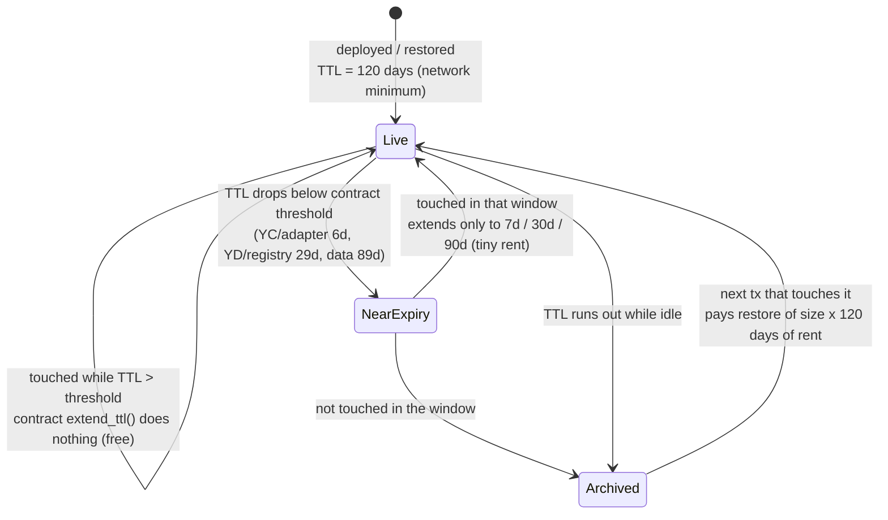

Why the contracts' own `extend_ttl` never helps:

| Contract | Threshold / extend-to | Harvest cadence | Result |
|---|---|---|---|
| Yield controller | 6 d / 7 d | 30+ d | window missed, expires ~120 d after last restore |
| Blend adapter | 6 d / 7 d | 30+ d | same |
| Yield distributor, registry | 29 d / 30 d | 30+ d | usually missed; when hit, buys only 30 d |
| Persistent data (YD, manager) | 89 d / 90 d | | fires on every touch after 1 day idle, buys 90 d |

Timeline that led to today's 53.7 XLM:

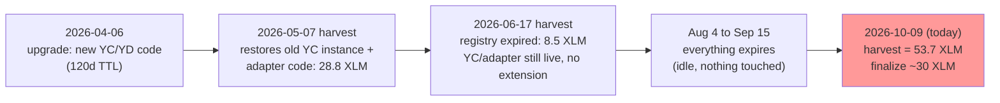

### 4.2 The harvest state machine and what each transition costs

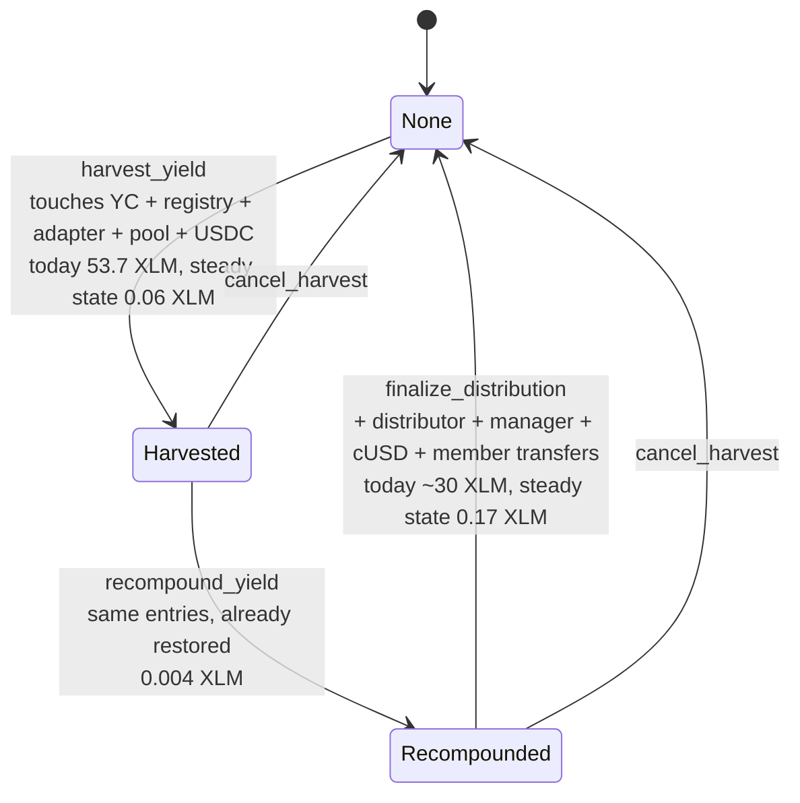

The split into three stages does not cost extra rent. Restoration is paid once by whichever stage touches an entry first,
which is why stage 2 is always almost free and stage 3 only pays for the distributor/manager side.

---

## 5. Harvest workflow in detail: who touches what

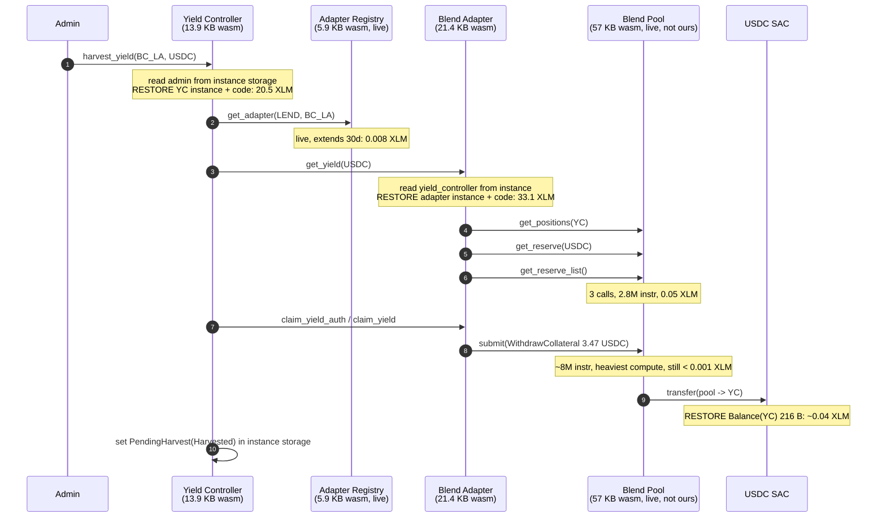

The CPU-heavy pieces (Blend `submit`, three pool reads for `get_balance`, repeated again in `finalize_distribution`)
total under 20M instructions and under 0.002 XLM. They are not where the money goes.

`finalize_distribution` follows the same pattern: first touch of the distributor code (21.9 XLM), manager instance + code
(7.4 XLM), then small data restores (cUSD SAC instance, balances, `CusdSupply`, `Distribution(n)`, `Members`, `Member`,
`TotalDistributed`, member and treasury trustlines) and N token transfers, one per member (N = 1 today).

---

## 6. Other things found along the way

- **Reads can be submitted as paid transactions.** `stellar contract invoke` defaults to `--send=default`, which submits
  whenever simulation shows ledger writes. A restore is a write. Running `make test-read-yield` today would submit
  `get_yield` and pay 53.6 XLM for a read. Use `--send=no` for anything that only reads.
- **The CLI pads the declared fee by ~15%.** May harvest: declared 331.4M, charged 288.1M. The difference is refunded; it
  is not a cost but it must be in the account balance.
- **Distribution history grows.** `get_distribution_history` restores every past `Distribution(n)` entry (476 B each, 0.09 XLM
  each after expiry). `record_distribution` rewrites the whole `Distributions` vector every epoch. Linear growth, small today.
- **Members are N ledger entries plus N transfers.** `record_distribution` reads every `Member(addr)` entry and `distribute_yield`
  does one cUSD transfer per member (each transfer touches that member's trustline). At 1 member this is noise; at hundreds it
  becomes the dominant compute and footprint of `finalize_distribution` (footprint cap is 400 entries per tx).
- **Rent rate is at the knee.** `rent_fee_per_1kb = -17,000 + 27,000 x state/3GB`, floored at 1,000. Live state is 1.95-1.97 GB.
  Above 2.0 GB the floor stops applying; at 2.5 GB the same restores cost ~5.5x, at 3 GB 10x, and a 5,000x growth factor applies beyond.
- **Blend's own entries are free for us.** The pool WASM (57 KB) and reserve entries are kept alive by every other Blend user.
  Only the controller's `Positions` entry and the USDC balances are ours to keep alive.
- **Protocol versions.** Mainnet runs protocol 29; the workspace is on `soroban-sdk` 26.1.1. Not a cost factor, noted for completeness.

---

## 7. What this means (analysis only, nothing changed)

The fee is not "gas" in the EVM sense. It is rent on ~59 KB of WASM, charged in 120-day lumps because the
contracts are only touched once a month and never keep themselves alive. Levers, in order of impact:

1. **Bytes of WASM on the ledger.** Rent is linear in (wasm bytes + compiled size). The adapter (21.4 KB) and the two 13.9 KB
   contracts are 90% of the bill. Fewer or smaller contracts is the only lever that lowers the total, not just the lumpiness.
2. **Keep entries alive deliberately** (an `ExtendFootprintTTL` operation from any account, or thresholds that match the
   cadence). This does not reduce total rent per day, it only converts 50-80 XLM surprises into ~0.75 XLM/day of predictable cost,
   and it avoids losing prepaid rent when code is upgraded.
3. **Never let a read submit.** `--send=no` on every `get_*` target.
4. **Budget for the rate increase.** Today's numbers are at the network floor rate.

Steady-state cost of one full cycle with everything live: **~0.24 XLM**. Cold-start cost today: **~84 XLM**.

---

## 8. The yield-claimer

NestJS service (`yield-claimer` repo), one cron job, signing with the admin key `GD2W…WIDB`, the same account
the Makefile uses as `ADMIN_KEY`. Deployed config (`.env`): `NETWORK=PUBLIC`, `CRON_EXPRESSION="0 0-23/12 * * *"`,
so it fires at 00:00 and 12:00 UTC. The `cronExpression` fields in `config.ts` are never read: the `@Cron`
decorator takes `process.env.CRON_EXPRESSION` at class-load time and falls back to every 30 seconds.

### 8.1 One tick, as it would run today

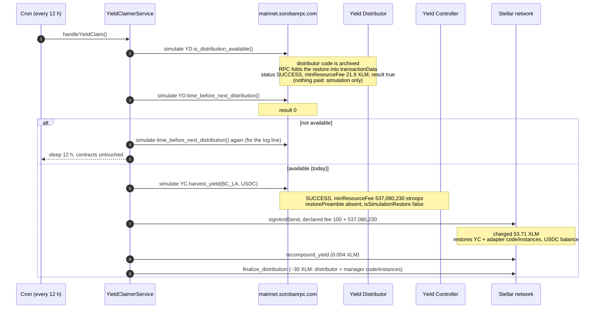

### 8.2 What the SDK declares today (simulation only, `scripts/sdk-probe.sh`)

| Call (as the claimer makes it) | Simulation status | `minResourceFee` | XLM | CPU instr | Entries written |
|---|---|---:|---:|---:|---:|
| `YD.is_distribution_available()` | SUCCESS, result `true` | 219,148,438 | 21.91 | 3.19M | 1 (distributor code) |
| `YD.time_before_next_distribution()` | SUCCESS, result `0` | 219,148,451 | 21.91 | 3.16M | 1 |
| `YD.get_distribution_info()` | SUCCESS, epoch 2 | 219,150,522 | 21.92 | 3.18M | 1 |
| `YD.get_total_distributed()` | SUCCESS, 2,531,735 | 218,697,853 | 21.87 | 3.05M | 2 |
| `YC.get_yield()` | SUCCESS, 3,468,588 | 536,138,661 | 53.61 | 9.88M | 4 |
| `YC.harvest_yield()` | SUCCESS | 537,080,230 | 53.71 | 18.36M | 8 |

The reads cost nothing because the claimer only takes `.result`. The writes go through `signAndSend` with
`fee = BASE_FEE + minResourceFee` and no check in between.

### 8.3 Why nothing has been claimed since June

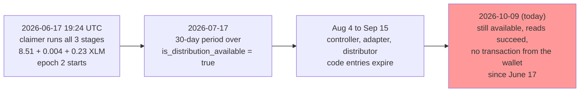

Evidence: the wallet's Horizon history shows the three June 17 invocations and then only unrelated 100-operation
XLM payments; no failed transactions (a failed submission would still appear, fee charged). The two reads the
claimer gates on both return the "go" values from here. So the service is not reaching the chain at all: not
deployed, not running, or failing before the RPC call. This is an operations finding, not a contract one, and it
is the reason the April restores were wasted (120 days of prepaid rent, two harvests used).

One candidate cause is in the repo: `docker-compose.yml` health-checks `http://localhost:3001/health`, but the
controller is mounted at `/yield-claimer`, so the route is `/yield-claimer/health` and `/health` returns 404.
Plain Docker only marks the container unhealthy; any orchestrator that acts on health (Swarm, Kubernetes, most
PaaS) restarts or stops it. The service's logs or host would confirm; they are not reachable from here.

Balance of the wallet: **512.95 XLM** (a 500 XLM payment left it on 2026-10-06). One cold cycle is ~84 XLM.

### 8.4 The restore branch is dead code

Since protocol 23 an `InvokeHostFunction` can restore archived entries itself (CAP-0062/0066,
`SorobanTransactionData.ext.v1.archivedSorobanEntries`). The RPC's `simulateTransaction` uses that: for an
invoke it never returns `restorePreamble`, it returns `SUCCESS` with the restore priced into `minResourceFee`.
Consequences:

- `rpc.Api.isSimulationRestore()` is always false for invokes; `assembledTx.restoreFootprint()` in
  `yield-claimer.service.ts` and in the front-end's `yieldController.ts` never runs. `transactionService.ts`
  in the front-end is not referenced at all.
- The historical May and June harvests confirm it: the envelopes carry `archived_soroban_entries`, there is no
  `RestoreFootprint` operation anywhere in the account history.
- `ExtendFootprintTTL` operations are different: extending an archived entry still returns a `restorePreamble`
  (measured on the adapter code), so a keep-alive job must restore first, then extend.
- The only place a 50 XLM surprise can be caught is by reading `minResourceFee` before signing. Neither
  codebase does.

### 8.5 Structural point

The claimer wakes ~60 times per distribution period and does nothing to the contracts on 59 of them. The
controller and adapter extend their own TTL only inside a harvest, by 7 days, with a 6-day threshold (section
4.1), so a monthly harvest never extends anything and the entries run down from their 120-day restore to
archival. The component that waits for the distribution is also the component that lets the state die.

Minor, not cost-related: `handleYieldClaim` calls `time_before_next_distribution` twice when not available;
`GET /yield-claimer/status` runs 7 simulations per request; the `cronExpression` config is dead.

---

## 9. The front-end

Next.js static export, `NEXT_PUBLIC_DEFAULT_NETWORK=PUBLIC`, RPC `https://mainnet.sorobanrpc.com` (the public
SDF endpoint), Horizon for balances and trustlines. Contract calls go through the same generated clients as the
claimer, constructed with the connected wallet as `publicKey`.

### 9.1 Reads: free, frequent

| Hook | Contract call | Interval | Page | Simulated fee today (never paid) | CPU instr |
|---|---|---|---|---:|---:|
| `useTimeBeforeNextDistribution` | `YD.time_before_next_distribution` | 1 s | `/yield-distribution` | 21.9 XLM | 3.2M |
| `useGetYield` | `YC.get_yield` | 3 s | `/yield-distribution` | 53.6 XLM | 9.9M |
| `useGetTotalAPY` | `YC.get_apy` | 5 s | `/yield-distribution` | same contracts as `get_yield` (not measured) | |
| `useGetTotalDistributed` | `YD.get_total_distributed` | 3 s | `/` (StatsPanel, account menu) | 21.9 XLM | 3.1M |
| `useGetCUSDTotalSupply` | `manager.cusd_total_supply` | 3 s | `/` (StatsPanel) | ~7.4 XLM (manager code + instance) | ~1.4M |
| `list_members`, `get_treasury_share`, `get_distribution_info`, `get_distribution_period` | once per mount | `/yield-distribution` | 21.9 XLM each | |
| `useAccount` / `useUserBalance` | Horizon `loadAccount` | on demand | `/` | n/a | |

Per open tab: `/yield-distribution` ≈ 1.5 simulations/s (~5,500/hour), `/` ≈ 0.7/s (~2,400/hour). The
`.result` path never signs, so none of this costs XLM. Three things are worth knowing anyway: the public RPC is
rate-limited and `get_yield` is a 9.9M-instruction simulation every 3 seconds; every simulation of a cold
contract also computes the restore footprint; and because the RPC returns `SUCCESS` even when cold, the UI keeps
showing numbers while a mint would cost 61 XLM.

### 9.2 Writes: the member pays whatever the simulation says

`mintCUSD` and `burnCUSD` (`services/ContractService/yieldController.ts`) simulate `deposit_collateral` /
`withdraw_collateral` with the user's wallet as source, then `signAndSend`. The declared fee is
`100 + minResourceFee`; there is no threshold, no confirmation beyond the wallet's own prompt.

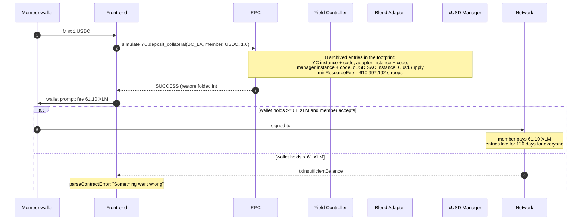

Measured today (simulation, nothing submitted):

| Action | Declared fee | XLM | CPU instr | Entries written | Of which restored |
|---|---:|---:|---:|---:|---:|
| Mint 1 USDC (`deposit_collateral`, wallet with USDC + cUSD trustline) | 610,997,192 | **61.10** | 14.9M | 14 | 8 |
| Burn 0.01 cUSD (`withdraw_collateral`, treasury wallet) | 610,996,205 | **61.10** | 15.4M | 14 | 8 |
| Either, with all entries live (from the resource counts) | ~150,000 | **~0.015** | same | 14 | 0 |

A warm mint costs 0.015 XLM; a cold one costs 4,000 times more, and whoever is first pays for the next 120 days of
everyone else's warmth. Between harvests this is a member, not the protocol.

### 9.3 Side notes (not fee related)

- `useTimeBeforeNextDistribution` and `useGetNextDistributionTime` share the query key `NEXT_DISTRIBUTION_TIME`;
  the 1-second poll overwrites the other's cache.
- `transactionService.ts` (with its own restore path) is dead code; `next.config.ts` has `ignoreBuildErrors: true`.

---

## 10. Contract-side findings from the second pass

### 10.1 A test mock ships in the mainnet adapter

`packages/blend_capital_adapter/src/lib.rs` has `pub mod mocks;` with no `cfg` gate. `mocks/blend_pool_mock.rs`
is a `#[contract]` + `#[contractimpl]` fake Blend pool, so its exports survive linking. The deployed adapter's
interface lists 27 functions; 11 are the mock's (`init`, `submit`, `submit_with_allowance`, `get_positions`,
`get_reserve`, `get_reserve_list`, `get_config`, `claim`, `update_b_rate`, `add_yield`, `get_user_emissions`).

Local experiment (built with `stellar contract build`, which optimizes by default; the source change was reverted):

| Adapter build | Optimized WASM bytes | Exported fns | Rent per 120 d at 1.6 XLM/KB | Upload cost |
|---|---:|---:|---:|---:|
| as deployed (`pub mod mocks;`) | 21,412 | 27 | 33.5 XLM | 33.5 XLM |
| `#[cfg(any(test, feature = "use_mocks"))] pub mod mocks;` | **16,656** | 16 | **26.0 XLM** | 26.0 XLM |

Minus 4,756 bytes (22%), about 7.4 XLM per 120 days and per upload. `stellar contract optimize` on the current
builds is a no-op (same bytes): there is nothing left for `wasm-opt` to take, only source.

### 10.2 Extending and restoring cost the same per day

| Operation (simulated) | Entry | New TTL bought | Fee | XLM | XLM per KB per 120 d |
|---|---|---|---:|---:|---:|
| `extend --wasm-hash 2651…` | registry code, 5,880 B, live (17 d left) | +103 d (to 120) | 81,933,497 | 8.19 | 1.66 |
| `extend --wasm-hash 2651…` | same | +13 d (to 30) | 9,793,085 | 0.98 | 1.57 |
| restore, June 17 harvest (actual) | registry code + instance + map | 120 d | 85,117,672 | 8.51 | 1.60 |
| `extend --id CA2BNJ…` | distributor instance, 548 B | +103 d | 922,423 | 0.092 | 0.20 |
| `extend --id CAKIIO…` | registry instance, 244 B | +103 d | 426,186 | 0.043 | 0.21 |
| `restore --wasm-hash 01f2…` | adapter code, archived | 120 d | 329,679,615 | 32.97 | 1.58 |
| `extend --wasm-hash 01f2…` | adapter code, archived | | returns `restorePreamble` | | must restore first |

Rent is linear in bytes and days, charged at the rate in force when the extension is bought. Two things follow:
keep-alive is a payment schedule, not a discount; and a long extension bought now locks today's floor rate for its
whole length (`max_entry_ttl` = 3,110,400 ledgers ≈ 180 days).

### 10.3 Releases pay the rent again

Owner account `GB4E…BNSR`, April 6 to 7 2026: four `UploadContractWasm` operations charged 19.23 + 17.73 + 6.39
+ 19.00 = **62.4 XLM**, plus ~1.2 XLM of upgrade and configuration invokes. A new WASM entry gets its own
120-day TTL at upload; whatever the old entry had prepaid is not refunded. The adapter has no `upgrade`
function, so replacing it means deploy + `register_adapter` (as was done once already: `BLEND_CAPITAL_ADAPTER_LEGACY`).

### 10.4 Makefile

No target passes `--send=no`. Every `get_*` target submits a paid transaction whenever the simulation contains a
write, and a restore is a write.

---

## 11. Who touches what, and who pays

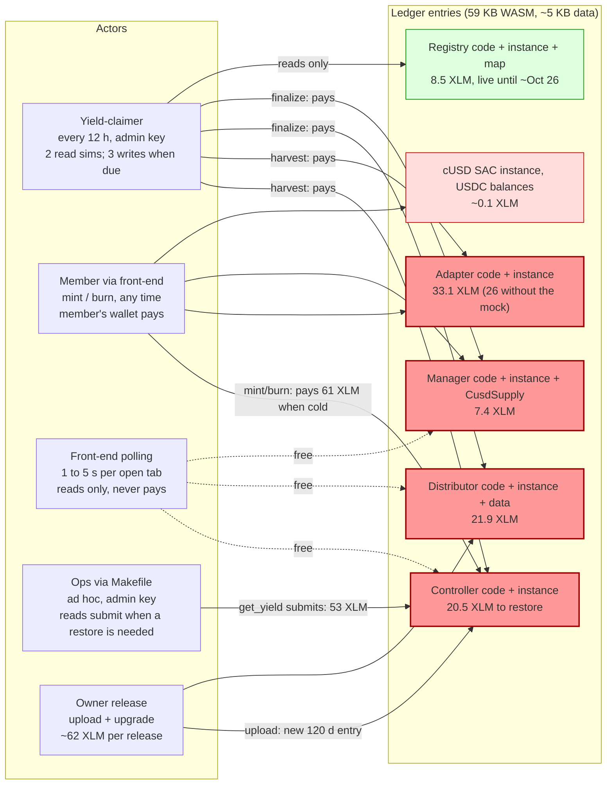

Nobody is assigned to keep the entries alive, so the bill lands on whoever arrives first after they expire:
the claimer at harvest time, a member at mint time, or ops running a read target.

---

## 12. Reproduce

Scripts in `scripts/` simulate against mainnet via RPC and never submit (they build with `--build-only` and POST
`simulateTransaction` directly). They need `stellar` CLI >= 26, `jq`, `curl`, and a funded mainnet identity for
the source account (default `admin-mainnet`, override with `SRC=`).

```bash
cd docs/gas-analysis/scripts
./simulate.sh harvest CAIYIGHOUS5CG5MYNW4TPOW635ZLXIBEFFXJ6J4Z5ZBO3UC344VZRP3N harvest_yield \
    --protocol BC_LA --asset CCW67TSZV3SSS2HXMBQ5JFGCKJNXKZM7UQUWUZPUTHXSTZLEO7SJMI75
./ttl.sh harvest     # size + liveUntilLedger of every entry in that footprint
stellar network settings --network mainnet   # current fee/rent parameters
```

Historical fees: `https://horizon.stellar.org/accounts/<admin>/transactions?order=desc&limit=200`, then decode
`envelope_xdr` with `stellar xdr decode --type TransactionEnvelope --output json` and look at
`tx.tx.ext.v1.resources` and `tx.tx.ext.v1.ext.v1.archived_soroban_entries`.

Second-pass measurements:

```bash
# the claimer's exact SDK calls, simulation only (needs node >= 22 and the claimer's node_modules)
./sdk-probe.sh ~/work/coopstable/yield-claimer

# what a member would pay to mint / burn today
./simulate.sh deposit  CAIYIG...RP3N deposit_collateral  --protocol BC_LA --user <wallet with USDC + cUSD trustline> --asset CCW67T...JMI75 --amount 10000000
./simulate.sh withdraw CAIYIG...RP3N withdraw_collateral --protocol BC_LA --user <wallet with cUSD>                  --asset CCW67T...JMI75 --amount 100000

# price of keeping an entry alive (build only, then POST the XDR to simulateTransaction as simulate.sh does)
stellar contract extend  --network mainnet --source admin-mainnet --wasm-hash <code hash> --ledgers-to-extend 2073600 --build-only
stellar contract extend  --network mainnet --source admin-mainnet --id <contract>         --ledgers-to-extend 2073600 --build-only
stellar contract restore --network mainnet --source admin-mainnet --wasm-hash <code hash> --build-only

# adapter without the test mock (revert afterwards)
sed -i 's/^pub mod mocks;$/#[cfg(any(test, feature = "use_mocks"))]\npub mod mocks;/' packages/blend_capital_adapter/src/lib.rs
stellar contract build --manifest-path packages/blend_capital_adapter/Cargo.toml && stat -c %s target/wasm32v1-none/release/blend_capital_adapter.wasm
git checkout -- packages/blend_capital_adapter/src/lib.rs
```

---

## 13. Actual charges, from the on-chain cost inputs

The figures in sections 2 and 10 are simulated `minResourceFee` values, which the RPC pads by ~15%. The network
charges rent as (`soroban-env-host` `e2e_invoke.rs`, `fees.rs`, `vm/parsed_module.rs`):

```
size_for_rent(data entry) = XDR bytes                                       no memory term
size_for_rent(code entry) = XDR bytes + wasm_module_memory_cost
wasm_module_memory_cost   = 17,564 + 50.4 x instructions + 371 x functions + 806 x imports + 505 x types
                            + 284 x exports + 105 x globals + 227 x data segments + 2 x data bytes
rent per 120 days         = size_for_rent x 1,666.67 stroops, divided by 3 for code entries
```

The memory term is the host's estimate of the parsed module's RAM; it is ~23x the raw WASM bytes and 85% of it
is the instruction count. It applies to code entries only: storing less contract data does not change it.

| Code entry | WASM B | instructions | memory cost B | XLM / 120 d | XLM / yr |
|---|---:|---:|---:|---:|---:|
| Blend adapter | 21,296 | 7,940 | 494,554 | 28.66 | 87.2 |
| Yield distributor | 13,806 | 4,587 | 327,992 | 18.99 | 57.8 |
| Yield controller | 13,838 | 4,358 | 304,952 | 17.72 | 53.9 |
| Adapter registry | 5,786 | 1,595 | 144,666 | 8.36 | 25.4 |
| cUSD manager | 4,165 | 1,059 | 109,710 | 6.33 | 19.3 |
| **All code** | 58,891 | 19,539 | 1,381,874 | **80.06** | **243.5** |
| All data entries (~5.5 KB) | | | 0 | ~0.9 | ~2.8 |

Check: the May 2026 harvest charged 28.81 XLM for the adapter code (28.66) plus the controller instance.

Rules of thumb at the floor rate: 1,000 WASM instructions = 8.5 XLM/yr; each contract carries ~40 KB of fixed
memory cost (constant + host imports) = 6.8 XLM/yr before any logic; 1 KB of ledger data = 0.5 XLM/yr.

```bash
python3 -I scripts/code_rent.py --state $(jq -r '.hashes[]' ../../mainnet.contracts.json)   # or: make code-rent
```
