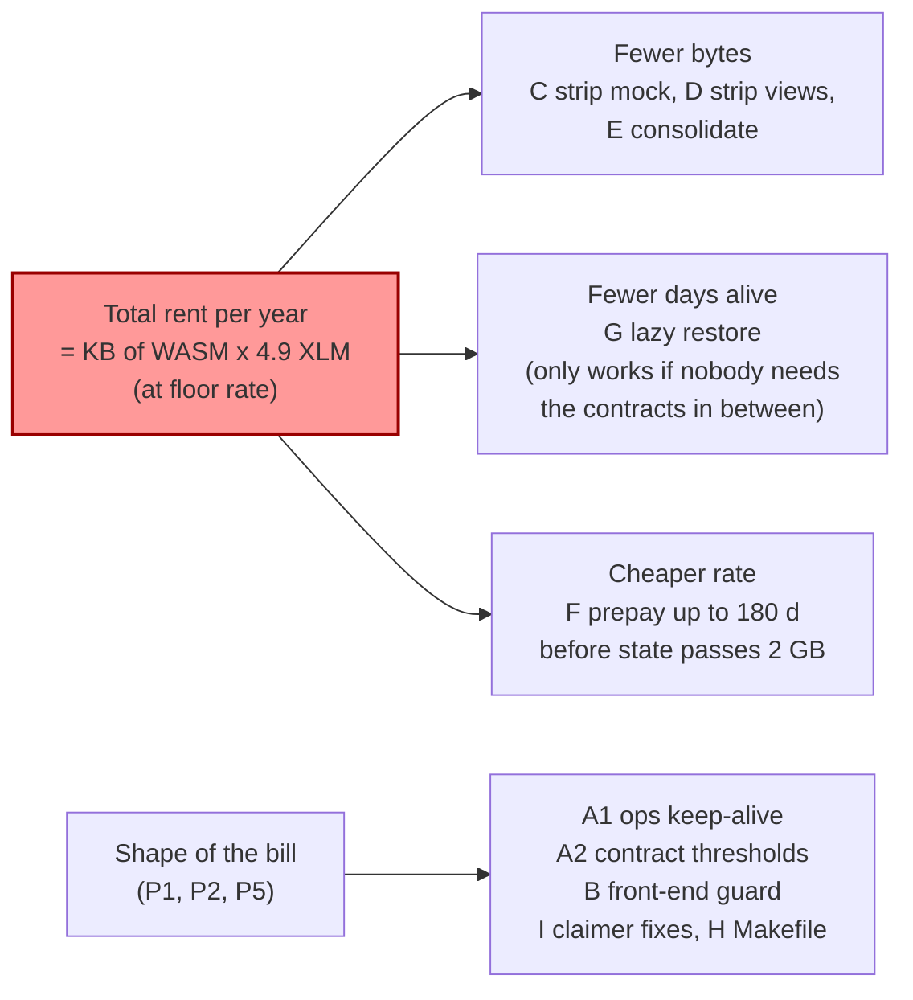
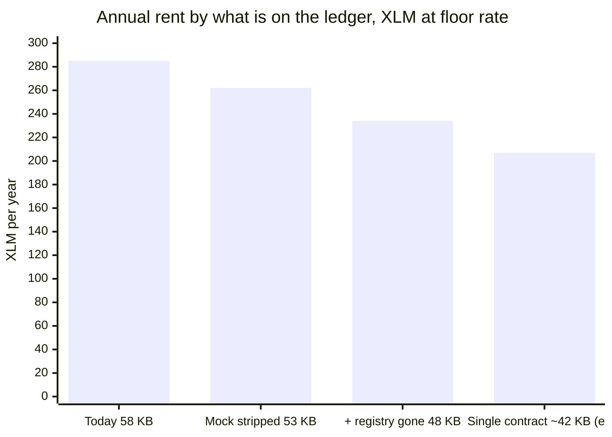
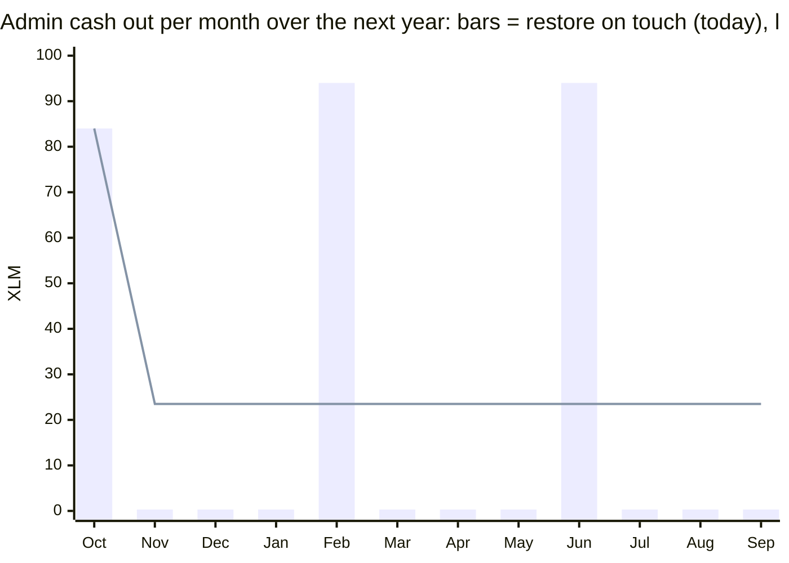
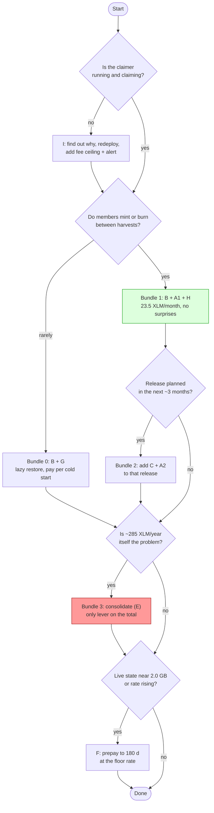

# Fee solutions: options and trade-offs

Companion to [README.md](README.md) (the measurements). Written 2026-10-09 against mainnet protocol 29 at the
floor rent rate. All XLM figures below come from that document; estimates are marked as such.

## 0. What "the fee problem" actually is

Four separate problems hide behind "harvesting is expensive". A solution can fix one without touching the others.

| # | Problem | Evidence | Who feels it |
|---|---|---|---|
| P1 | **Lumps.** The bill arrives as 30 to 90 XLM surprises instead of a predictable cost | 0.004 XLM to 53.7 XLM for the same call, depending only on what expired | Ops, treasury |
| P2 | **Wrong payer.** Whoever touches a cold contract first pays 120 days of rent for everyone | Mint or burn today = 61.10 XLM from the member's wallet | Members |
| P3 | **Total.** ~59 KB of WASM costs ~285 XLM/year to exist at today's rate, whoever pays and however smoothly | 1.6 XLM per KB per 120 days, measured both as restore and as extension | Treasury |
| P4 | **Rate risk.** Rent is at the network floor; it leaves the floor at 2.0 GB of live state (now 1.95 GB) and reaches 10x at 3 GB | Network settings | Everyone |
| P5 | **Reliability.** The claimer has not claimed since June 17; nothing keeps entries alive by design | Horizon history, claimer code | Members, ops |

Two measured facts drive every trade-off below:

1. **Rent is linear in bytes and days and does not care how you pay it.** Extending a live entry by 30 days costs
   the same per day as restoring it for 120. Keep-alive is a payment plan, not a discount.
2. **The only ways to pay less are fewer bytes, or fewer days** (letting entries die while nobody needs them),
   **or a cheaper rate** (prepaying before the rate rises).

## 1. Cost model used below

| Constant | Value | Source |
|---|---|---|
| WASM on the ledger | 59,360 B (58.0 KB) across 5 contracts | README section 3 |
| Rent, contract code | **1.6 XLM per KB per 120 days** (measured 1.46 to 1.66) | README 2.3, 10.2 |
| Rent, data | 0.2 XLM per KB per 120 days | README 2.3, 10.2 |
| Whole footprint, alive | 94 XLM / 120 d = **0.78 XLM/day = 23.5 XLM/month = 285 XLM/year** | derived |
| Cold start (everything expired, one full cycle) | ~84 XLM (harvest 53.7 + finalize ~30) | README 2.2 |
| Warm cycle (everything live) | ~0.24 XLM | README 2.1, Feb 2026 |
| Upload of a new WASM | 1.6 XLM per KB, 120 days prepaid, old entry's prepaid rent lost | README 10.3 |
| Longest prepayment | 180 days (`max_entry_ttl` 3,110,400 ledgers) | network settings |
| Admin wallet | 512.95 XLM | Horizon |

## 2. Options

Each option: what it is, what it costs, what it saves, effort, risks, what it does *not* do, and a verdict.
Effort is a rough engineering estimate, not a quote.

### A1. Ops keep-alive: extend TTLs on a schedule (claimer or cron)

**What.** Once a month, from the admin key, extend every Coopstable entry to 120 days: 5 code entries (by WASM
hash), 5 instances, and the ~10 persistent data keys (distributor `Members`, `Member(addr)`, `Distributions`,
`Distribution(n)`, `TotalDistributed`; manager `CusdSupply`; registry `LEND` map; the controller's USDC balance and
the cUSD SAC instance). Each extension pays only the days it adds. Archived entries must be restored first (or
simply run the job right after the next harvest, which restores everything).

Laziest implementation: a shell script of `stellar contract extend` calls, one per key, on the claimer's host
cron. One transaction per entry, ~0.01 XLM overhead each. A single `ExtendFootprintTTL` operation with all keys
via the SDK is ~60 lines of TypeScript if one transaction is preferred.

| | |
|---|---|
| Cost | 23.5 XLM/month, same total as today (285/yr). Plus ~0.2 XLM/month of transaction overhead |
| Saves | Nothing on the total. Removes P1 and P2 entirely while the job runs |
| Effort | Half a day (script) to one day (SDK, inside the claimer) |
| Risks | If the job stops, the system silently returns to today's behaviour. Pays rent during idle months that restore-on-touch would not have paid (July to October would have cost ~85 XLM for nothing) |
| Does not | Lower the bill; protect against the rate rising; fix the claimer |
| Verdict | **Do it now** if members are expected to mint or burn between harvests. It is the cheapest fix for P2 |

### A2. Contract-side keep-alive: fix the TTL thresholds

**What.** The controller and adapter extend their own instance (and code) only when under 6 days of TTL, and only
to 7 days; the distributor and registry use 29/30 days. Change the constants so any touch extends to 120 days when
below, say, 45 days (`INSTANCE_BUMP_AMOUNT = 120 * DAY_IN_LEDGERS`, threshold 45 days; same for persistent data).
`instance().extend_ttl` extends the instance *and* the code entry. A monthly harvest then keeps everything it
touches alive without any off-chain job; the finalize stage covers the distributor and manager.

| | |
|---|---|
| Cost | Same rent as A1. One-time: uploads of every changed contract (controller 22, distributor 22, adapter 26 to 33, registry 9, manager 7 XLM) |
| Saves | Nothing on the total; removes the dependency on an off-chain job, as long as harvests keep happening |
| Effort | Two constants per contract, tests, a release |
| Risks | Only works while harvests run monthly (P5 again). Uploads cost ~60 to 90 XLM, so never ship this on its own |
| Does not | Help between now and the next release; cover entries a harvest does not touch |
| Verdict | **Fold into the next release**, not a standalone deploy. A1 covers the gap until then |

### B. Front-end cold guard

**What.** After simulation, before `signAndSend`, refuse to prompt the wallet when `minResourceFee` exceeds a
threshold (0.5 XLM is 30x a warm mint) and show "the protocol is warming up, try again in a few minutes"
instead. Optionally ping the claimer to run A1 on demand. Five to ten lines in `yieldController.ts`.

| | |
|---|---|
| Cost | 0 XLM |
| Saves | Nothing directly. Stops members from paying 61 XLM (P2) and from hitting `txInsufficientBalance` |
| Effort | Half a day including a message in the transaction dialog |
| Risks | Without A1 or G, members are simply blocked while cold |
| Does not | Warm anything |
| Verdict | **Do it regardless** of everything else; it is the safety net under A1 and the enabler of G |

### C. Strip the test mock from the adapter

**What.** `#[cfg(any(test, feature = "use_mocks"))]` on `pub mod mocks;` in
`packages/blend_capital_adapter/src/lib.rs`. Measured: 21,412 to 16,656 bytes (22%), 27 to 16 exported
functions. Tests still compile (`test.rs` is `cfg(test)`; nothing outside the crate imports the mocks). Run
`make test` to confirm before shipping.

| | |
|---|---|
| Cost | One-time: new adapter deploy (26.0 XLM upload, the adapter has no `upgrade`), `register_adapter`, config update in claimer and front-end |
| Saves | **7.4 XLM per 120 days (23 XLM/year)** and 7.4 XLM off every future adapter upload |
| Effort | One line, one test run, one redeploy |
| Risks | Redeploy risk only (done once before: `BLEND_CAPITAL_ADAPTER_LEGACY`). The old code entry is already archived, so no prepaid rent is lost today |
| Does not | Change the shape of the bill |
| Verdict | Standalone payback is ~14 months. **Ship with the next adapter change**; or now, if the adapter is being redeployed anyway |

### D. Strip ops-only views from the contracts

**What.** Remove functions nothing calls except the Makefile (`get_emissions`, `claim_emissions`,
`get_distribution_history`, `get_adapters_with_assets`, registry listing, …). Not measured; estimate 1 to 3 KB
across the controller and distributor (2 to 5 XLM per 120 days).

| | |
|---|---|
| Cost | Uploads of the controller and distributor (~44 XLM) |
| Saves | 6 to 15 XLM/year (estimate) |
| Effort | One to two days, loses ops tooling |
| Verdict | **Skip.** Payback is years and the views are useful. Only consider inside E |

### E. Consolidate contracts

**What.** One contract (the controller, upgraded in place so Blend positions keep their address) absorbing the
adapter (as a Rust module), the registry (an address in instance storage) and, if feasible, the manager.
Estimate after C: 58 KB to roughly 40 to 45 KB, i.e. **195 to 220 XLM/year** instead of 285. Fewer, smaller uploads
per release (one WASM instead of four or five; the April release would have been ~65 XLM lighter). Removes three
cross-contract hops (CPU is irrelevant to the fee, but it simplifies auth).

| | |
|---|---|
| Cost | Weeks of engineering plus an audit pass. One-time upload of the merged WASM (~70 XLM). Migration of registry and member state |
| Saves | ~65 to 90 XLM/year (estimate) and ~40 XLM per release |
| Effort | 2 to 4 weeks |
| Risks | Migration. The cUSD SAC admin is presumably the manager contract; moving minting into the controller needs the SAC admin reassigned, which needs a one-off manager upgrade first (verify who the admin is before planning). A single contract is also a single upgrade blast radius |
| Does not | Change the fact that something must keep it alive (A1/A2 still needed) |
| Verdict | Only lever that materially reduces P3. **Worth it only if a redesign is on the roadmap anyway**; the yearly saving does not fund the work |

### F. Prepay rent before the rate rises

**What.** Right after the next restore (entries at 120 days), extend everything to the 180-day maximum. Cost now:
58 KB x 1.6 x 0.5 = **~46 XLM** for 60 extra days at the floor rate. If live state passes 2.0 GB the rate climbs
linearly to 10x at 3 GB; at 2.5 GB the same 60 days would cost ~250 XLM.

| | |
|---|---|
| Cost | 46 XLM of liquidity now; repeat every ~2 months to stay at the 180-day horizon |
| Saves | Up to ~200 XLM per hedged 60 days if the rate hits 5x; nothing if the rate stays at the floor (the rent was due anyway) |
| Effort | One command per entry, or the A1 job with a longer target |
| Risks | Prepaid rent on code that gets replaced by a release is lost; the hedge is only worth its expected rate increase. State growth rate is unknown (check `live_soroban_state_size` monthly) |
| Verdict | **Cheap insurance, add to A1** when state is within ~5% of 2.0 GB or a release is not imminent |

### G. Lazy restore: accept being cold, pay on demand, never let a member pay

**What.** No keep-alive. The claimer restores at harvest time (already the case); B blocks mint and burn while
cold; a "warm up" action (claimer endpoint or ops) restores everything on request (~84 XLM, then 120 days live).
Harvest cadence can even be lowered.

| | |
|---|---|
| Cost | ~94 XLM per cold start, only when someone needs the contracts. Two cold starts a year = ~190 XLM |
| Saves | Rent for the months nobody uses the protocol (the only option that can beat 285/yr without touching bytes) |
| Effort | B plus one endpoint, one day |
| Risks | Worst UX: a member waits minutes for a restore after asking. Lumps remain (P1). A 500 XLM payment from the admin wallet on 2026-10-06 shows how a lump can collide with other uses of that account |
| Verdict | Right answer **only if usage is sporadic and the treasury prefers lumps to a standing cost** |

### H. Makefile hygiene: `--send=no` on read targets

`test-read-yield`, `get-pending-harvest`, `get-balances`, `get-adapters`, `get-distribution-history` and every
other `get_*` target. Zero cost, minutes of work, removes the "53 XLM read" trap. **Do it.**

### I. Claimer reliability

1. Find out why it stopped (candidate: the Docker healthcheck path `/health` vs `/yield-claimer/health`), redeploy,
   and alert when a distribution has been available for more than a day without a claim.
2. Before `signAndSend`, compare `minResourceFee` to a ceiling (e.g. 100 XLM) and alert instead of paying when
   exceeded. This is the only guard against a silent 5x rate jump.
3. Budget: a cold cycle is ~84 XLM; the wallet holds 513 and is also used for payments.
4. Optional cleanup: drop the dead `restoreFootprint` branch, the duplicate time read, the dead `cronExpression`.

Zero XLM, about a day. **Do it first**; nothing else matters while the claimer is down.

## 3. Comparison

| Option | P1 lumps | P2 member pays | P3 total | P4 rate | P5 reliability | Rent/yr after | One-time XLM | Effort |
|---|:-:|:-:|:-:|:-:|:-:|---:|---:|---|
| Today | | | | | | 285 (if harvests resume) | | |
| A1 ops keep-alive | yes | yes | no | no | partly | 285 | 0 (84 via next harvest) | 0.5 to 1 day |
| A2 contract thresholds | yes | yes | no | no | no | 285 | 60 to 90 (uploads) | small + release |
| B front-end guard | | yes | no | no | | 285 | 0 | 0.5 day |
| C strip mock | | | small | | | 262 | 26 | 1 line + redeploy |
| D strip views | | | tiny | | | 250 to 255 (est.) | ~44 | 1 to 2 days |
| E consolidate | | | **yes** | | | 195 to 220 (est.) | ~70 + audit | 2 to 4 weeks |
| F prepay 180 d | | | | **yes** | | 285 at floor, locked | 46 per top-up | minutes |
| G lazy restore | no | yes | if idle | no | | 0 to 285, usage-dependent | 94 per cold start | 1 day |
| H `--send=no` | | | | | yes | | 0 | minutes |
| I claimer fixes | | | | guard | **yes** | | 0 | 1 day |

Both series consume the same 23.5 XLM of rent per month (the line ends the year with 120 days prepaid, the bars
with about 30). The bars assume monthly harvests resume; in reality the bar lands on whoever shows up first, and
between July and October that would have been a member.

## 4. Bundles

**Bundle 1, stop the bleeding (this week, 0 XLM beyond the rent already due).** I + H + B + A1.
Outcome: the claimer runs and refuses absurd fees; members never see a 61 XLM prompt; the bill becomes 23.5 XLM a
month; the Makefile cannot submit reads by accident. Total unchanged. Add F when state nears 2 GB.

**Bundle 2, diet at the next release (adds ~26 XLM one-time, saves ~23 XLM/year).** Bundle 1 + C + A2.
Outcome: adapter 22% smaller, contracts keep themselves alive while harvests run, A1 stays as the backstop.

**Bundle 3, re-architecture (weeks, ~70 XLM one-time, saves ~65 to 90 XLM/year).** Bundle 2 + E.
Outcome: one or two contracts, rent around 200 XLM/year, releases ~40 XLM cheaper. Justified by roadmap, not by
rent.

**Bundle 0, lazy (cheapest if usage is sporadic).** I + H + B + G. Outcome: pays ~94 XLM per cold start only when
needed; members wait while cold. Mutually exclusive with A1/A2.

## 5. Open questions: closed and still open

| Question (from the first pass) | Status |
|---|---|
| Can shrinking or merging WASM cut the fixed ~93 XLM/120 d? | **Answered.** Mock strip: measured 22% off the adapter (7.4 XLM/120 d). Merge: estimated ~30% off the total, needs a build to confirm. Bytes are the only lever on the total |
| Would a monthly `ExtendFootprintTTL` job (~23 XLM/month) be the same total, just smoother? | **Confirmed by measurement.** Extension and restore cost the same per day (8.19 vs 8.51 XLM on the registry code). Implementation is a dozen CLI calls on a cron |
| `--send=no` on read targets | Still to do; zero cost (H) |
| Why did harvesting stop after June 17? | **New.** Not a contract problem: reads succeed, nothing is submitted. Candidate: wrong healthcheck path in `docker-compose.yml`. Needs the service host or logs |
| Who pays when a member mints while cold? | **New, measured.** The member: 61.10 XLM declared today |
| How fast is live Soroban state growing toward 2.0 GB? | Open. Decides whether F is worth doing now |
| Is the cUSD SAC admin the manager contract? | Open. Decides how hard E is |

## 6. If Bundle 1 is chosen: order of work

1. Claimer: diagnose, fix the healthcheck path, add the fee ceiling and the "available but unclaimed" alert, redeploy. Expect ~84 XLM on the first run.
2. Makefile: `--send=no` on every read target.
3. Front-end: fee threshold before `signAndSend`, message in the dialog.
4. Keep-alive: run right after the first harvest (everything is live then), schedule monthly. Decide the target (120 days, or 180 for F).
5. Write down the list of ledger keys the job extends and check it whenever a contract is added or replaced.

## 7. Decision (2026-10-09): Bundle 2, admin-paths-only variant of A2

Implemented in code across the three repositories; not yet deployed. Rehearsal and rollout:
`docs/migration/bundle-2-testnet.md`.

| Where | What |
|---|---|
| Contracts | Bump amounts 120 days everywhere. TTL extension only on admin-signed paths: controller `require_admin`/`require_owner`; adapter `claim_yield`, `claim_emissions`, `update_epoch_principal`, `upgrade`; manager `require_admin`/`require_owner` (instance + `CusdSupply`); registry writes only (no extension on the `get_adapter` read every deposit makes). Mint and burn never carry an extension. Tests assert it per contract |
| Adapter (C) | Mock pool gated behind `cfg(test)`: 21,296 to 17,088 bytes and 11 fewer exports. The deployed mock's `submit` wrote unauthenticated per-user entries into the adapter's shared instance storage, so stripping it also closes a bricking vector. New `owner` + `upgrade`; the constructor adopts the controller's existing Blend position as the opening principal, so a replacement adapter cannot report that position as yield |
| yield-claimer (I, A1) | Healthcheck path fixed; fee ceiling `MAX_FEE_XLM` on every signature; 24 h stale-distribution alert; keep-alive every tick for the 5 code + 5 instance entries plus the registry map, `CusdSupply`, the cUSD token instance and the controller's USDC balance (the adapter id is read from the registry, so a swap cannot leave a stale id) |
| front-end (B) | Mint and burn refuse to prompt the wallet above 0.5 XLM of simulated fee |
| Makefile (H) | `--send=no` on all reads; `upgrade-all`, `keep-alive` (with the data keys), `code-rent`; the adapter deploy passes `--owner` and `--asset` |

Why not the rest: G costs the same as keep-alive at a monthly cadence and blocks members while cold; D and the
storage-field trim are worth 1 to 5 XLM/yr and most trims would need a storage migration; E is a redesign.

Corrections to the figures above: RPC simulation pads rent by ~15%; actual charges at the floor rate are
**80.06 XLM per 120 days (243.5 XLM/yr)** for the five code entries today, about 74 after the adapter swap,
and ~0.9 XLM per 120 days for all data (README section 13). Live state is 1.76 GB, not 1.95. Storing less
contract data does not reduce the memory term of rent: that term exists only on code entries.
